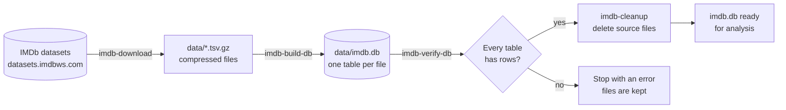
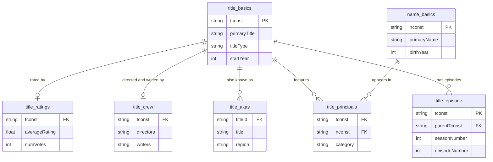

# IMDb Analytics
 
[](https://github.com/SyNikolai/imdb-analytics/actions/workflows/pipeline.yml)

[](https://github.com/astral-sh/uv)
[](https://github.com/astral-sh/ruff)


 
A data pipeline that downloads the public [IMDb datasets](https://developer.imdb.com/non-commercial-datasets/), loads every file into its own table of a single SQLite database, verifies the result and cleans up after itself, leaving one `imdb.db` file ready for analysis.
 
## Pipeline
 

 
| Step | Command | What it does |
|---|---|---|
| Download | `uv run imdb-download` | Finds every `.tsv.gz` link on the IMDb datasets page and streams each file to `data/` with a progress bar |
| Build | `uv run imdb-build-db` | Reads each file with pandas in chunks and writes it to its own SQLite table, then indexes the join keys |
| Verify | `uv run imdb-verify-db` | Checks that the database exists and that no table is empty, and prints a row count report |
| Clean up | `uv run imdb-cleanup` | Deletes the downloaded files once the database exists and reports the disk space freed |
 
A few design choices keep the pipeline light on resources:
 
- **Constant memory use.** Downloads are streamed 1 MB at a time and files are loaded in chunks of 500,000 rows, so even the largest file never has to fit in RAM.
- **No unzip step.** pandas reads the `.gz` files directly, so the uncompressed data never touches the disk.
- **Verification before deletion.** The source files are only removed after the database has passed its checks.
## Database
 
Each IMDb file becomes one table, and the tables connect through IMDb's title IDs (`tconst`) and person IDs (`nconst`). Those join columns are indexed during the build.
 

 
The diagram shows the key columns of each table; the full column list is in [IMDb's dataset documentation](https://developer.imdb.com/non-commercial-datasets/).
 
## Getting started
 
You need [uv](https://docs.astral.sh/uv/) and a few GB of free disk space for the database. uv installs the right Python version for you.
 
```bash
git clone https://github.com/SyNikolai/imdb-analytics.git
cd imdb-analytics
uv sync
```
 
Then run the full pipeline. Each step only runs if the previous one succeeded:
 
```bash
uv run imdb-download && uv run imdb-build-db && uv run imdb-verify-db && uv run imdb-cleanup
```
 
The finished database is at `data/imdb.db`. The `data/` folder is git-ignored, so no IMDb data is ever committed to the repository.
 
## Project structure
 
```
imdb-analytics/
├── .github/workflows/
│   └── pipeline.yml          # CI: lint and full pipeline run
├── src/imdb_analytics/
│   ├── data_downloader.py    # imdb-download
│   ├── database_builder.py   # imdb-build-db
│   ├── database_verifier.py  # imdb-verify-db
│   └── data_cleaner.py       # imdb-cleanup
├── data/                     # created at runtime, git-ignored
├── pyproject.toml
└── uv.lock
```
 
## Continuous integration
 
The whole pipeline runs on GitHub Actions, against the real IMDb data.
 

 
- **Lint** checks the code with ruff on every run.
- **Pipeline** downloads the data, builds and verifies the database, and publishes a row count report to the run's summary page. The database is not uploaded; the job exists to prove the pipeline works end to end.
- **Triggers:** pushes to `main` that change code or dependencies, a weekly scheduled run that catches changes on IMDb's side, and a manual **Run workflow** button.
## Roadmap
 
- [x] Download the IMDb datasets
- [x] Build a SQLite database with one table per file
- [x] Verify the database and clean up the source files
- [x] Run the pipeline in CI
- [ ] Queries and data analysis
Queries and data analysis are a work in progress and will be added in future commits initially through the jupyter notebook then in a web app that will include interactive dashboards and graphs.
 
## Data source and license
 
Data source: (https://www.imdb.com).
 
The IMDb datasets are available for personal and non-commercial use only, under the [IMDb non-commercial dataset terms](https://developer.imdb.com/non-commercial-datasets/). This repository contains only the code that downloads and processes the data; it does not contain or redistribute any IMDb data.